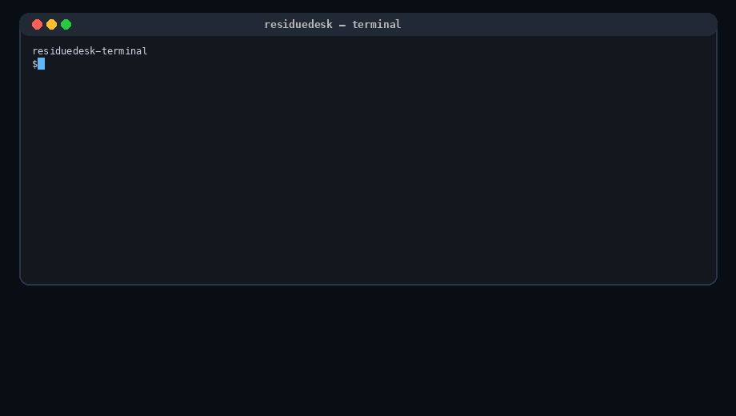
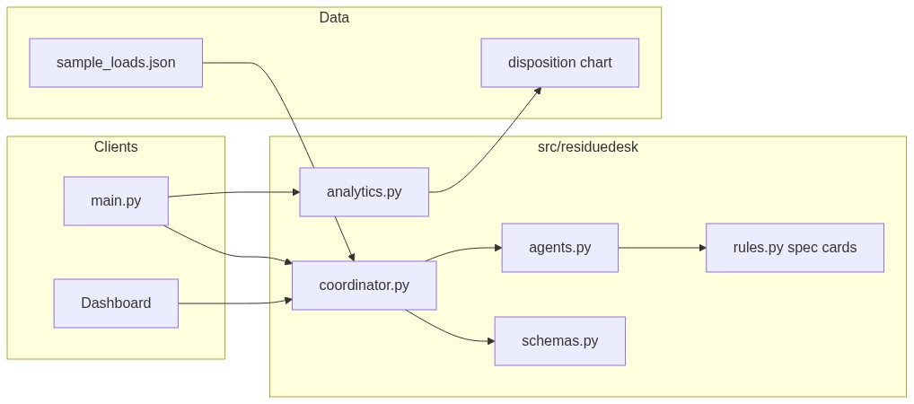
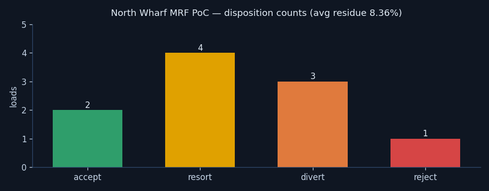
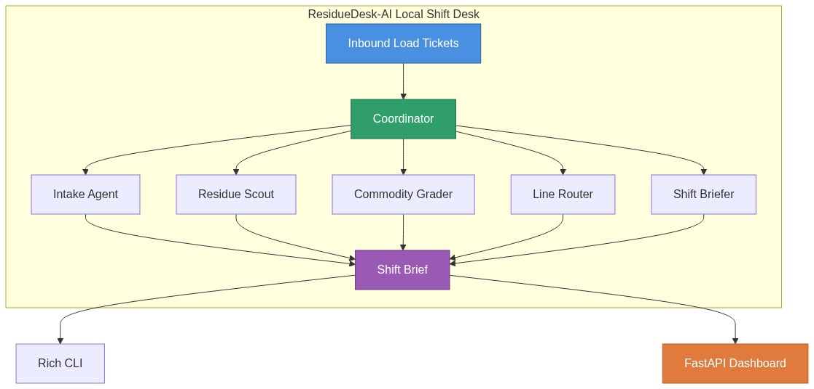
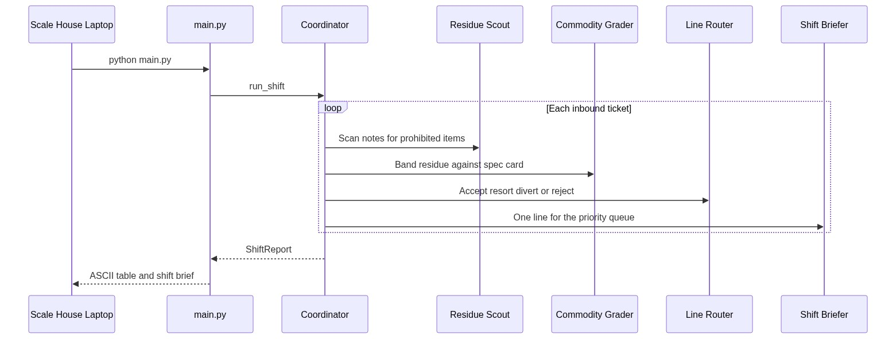
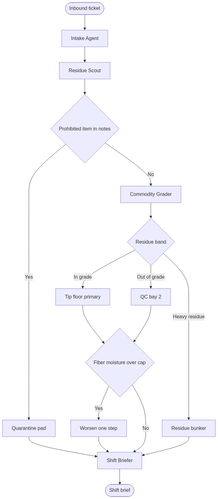

# ResidueDesk-AI

### How I Turned Inbound Bale Tickets into Accept, Resort, or Divert Calls

ResidueDesk-AI is a local multi-agent shift desk for a materials recovery facility. The semantic model in `src/residuedesk/semantic.py` is the layer the desk reads: a Load entity, Commodity and Supplier dimensions, three measures (`NetWeightLb`, `ResiduePercent`, `MoisturePercent`), and commodity metric bindings. Agents do not invent those definitions. They project each ticket onto that model, then write an accept, resort, divert, or reject brief. The thresholds are experimental. They are not a mill contract.



## What it does

A scale-house ticket already has the awkward fields: commodity, net weight, a residue percent from a spot check, moisture, and a free-text note. The hard part is the call. Accept it on the primary line, send it to a resort bay, divert it to the residue bunker, or quarantine it because the note mentions a battery.

ResidueDesk-AI makes that call in the open:

1. The intake agent checks weight, supplier, and timestamp.
2. The residue scout scans the note for prohibited items.
3. The commodity grader bands residue against a spec card.
4. The line router applies moisture and ceramic overrides.
5. The shift briefer writes one line per load, with reject and divert first.

No model API key is required. The coordinator is plain Python so a clone can finish a sample shift in a minute.



## Sample shift

The bundled tickets are a fictional morning at a place I called North Wharf MRF. Ten loads. The run I checked while writing this README landed on:

1. Accept: 2
2. Resort: 4
3. Divert: 3
4. Reject: 1
5. Average residue: 8.36 percent



LD-106 is the one I keep using as a sanity check. Residue is only 3.1 percent, which would have been an accept on the HDPE card, but the note says a battery pack is in the third gaylord. The router quarantines it. That override is the whole point of keeping the scout separate from the grader.

## Repository layout

```
ResidueDesk-AI/
├── main.py
├── sample_loads.json
├── requirements.txt
├── src/residuedesk/
│   ├── schemas.py
│   ├── semantic.py
│   ├── rules.py
│   ├── agents.py
│   ├── coordinator.py
│   ├── analytics.py
│   └── api.py
├── static/dashboard.html
├── tests/test_triage.py
└── images/
```

## Setup

Python 3.11 or newer.

```bash
git clone https://github.com/aniket-work/ResidueDesk-AI.git
cd ResidueDesk-AI
python -m venv .venv
source .venv/bin/activate
pip install -r requirements.txt
```

On Windows, activate with `.venv\Scripts\activate`.

## Run the shift

```bash
python main.py --chart images/disposition-chart.png
```

You should see a Rich table, then a shift brief that lists reject and divert ahead of accepts. Add `--json-out shift.json` if you want the same report as JSON for a diff after you edit a threshold.

Tests:

```bash
python -m pytest tests -q
```

Dashboard, same coordinator, browser UI:

```bash
uvicorn src.residuedesk.api:app --reload
```

Open `http://127.0.0.1:8000` and use **Run sample shift**.

## Design notes



Spec cards live in `src/residuedesk/rules.py`. I kept them as short paragraphs with an id such as `SPEC-OCC-01` so the trace can point at the card the grader used. Fiber commodities (OCC and mixed paper) worsen one step when moisture crosses the cap. Glass with a ceramic note diverts even when residue is inside the accept band. A ticket under 400 lb that would otherwise accept is sent to the resort bay, because a partial bale has burned me in sample data before.





## Limits

This is a personal experiment. The thresholds are mine. There is no camera model, no scale-house integration, and no pricing logic. A human still owns the quarantine pad. If you change a number in `SPECS`, run the tests and read the brief. The trace on each decision is there so a surprising call is explainable without opening a debugger first.

## License

MIT. See [LICENSE](LICENSE).
